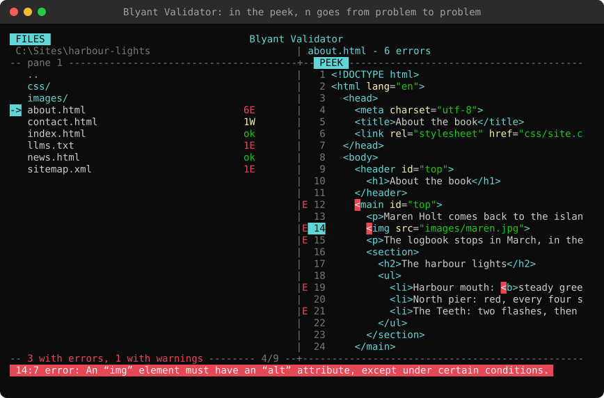
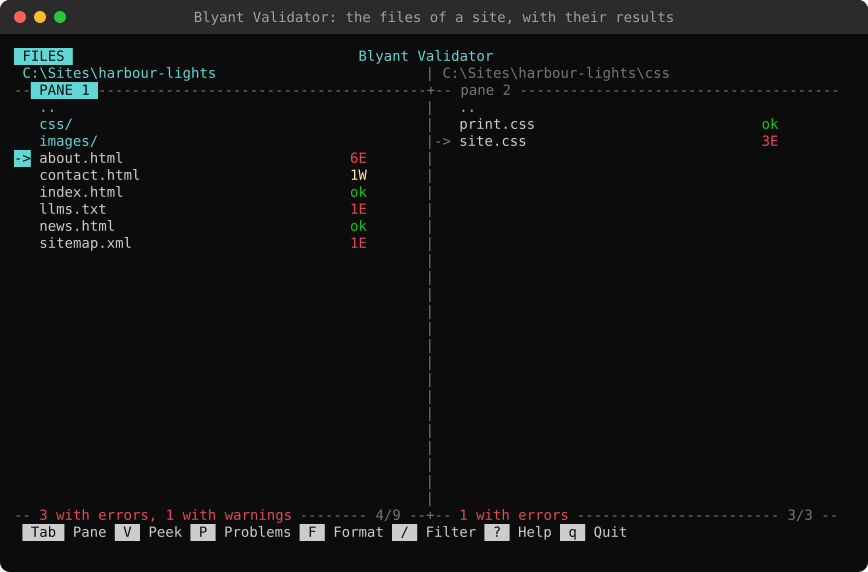
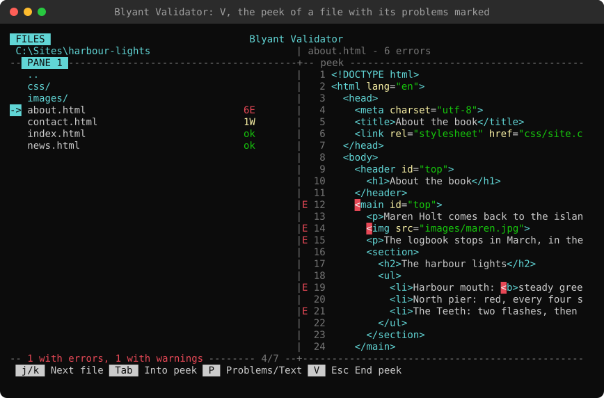
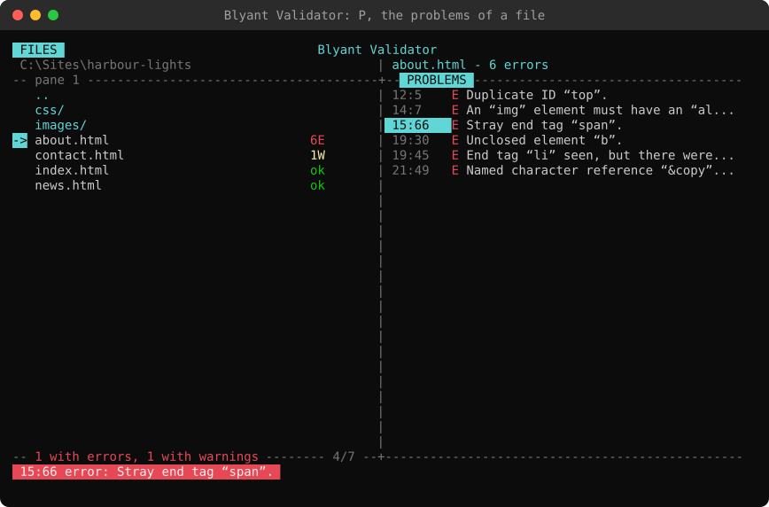
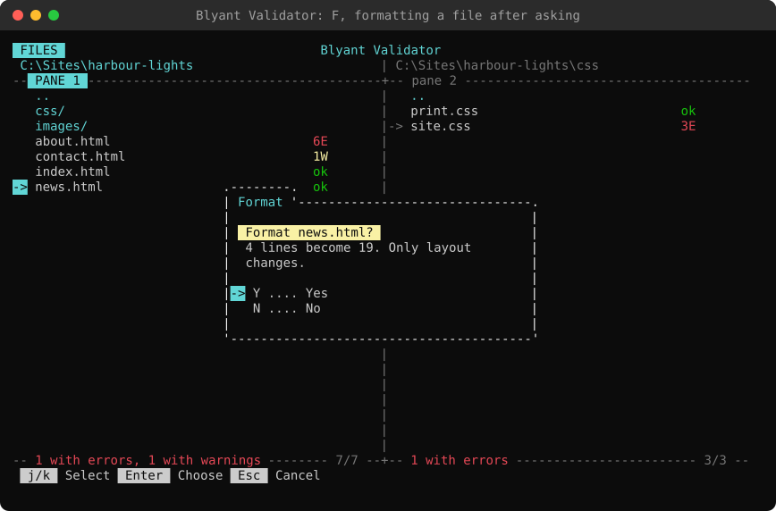
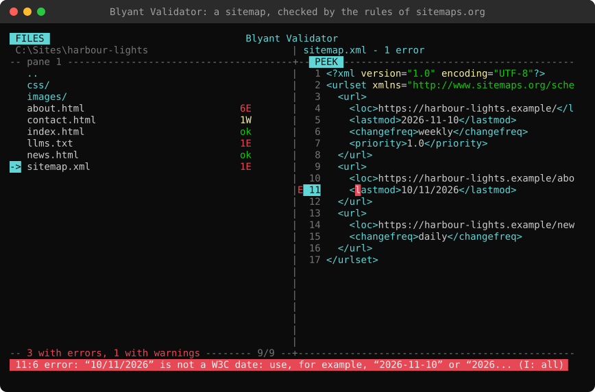
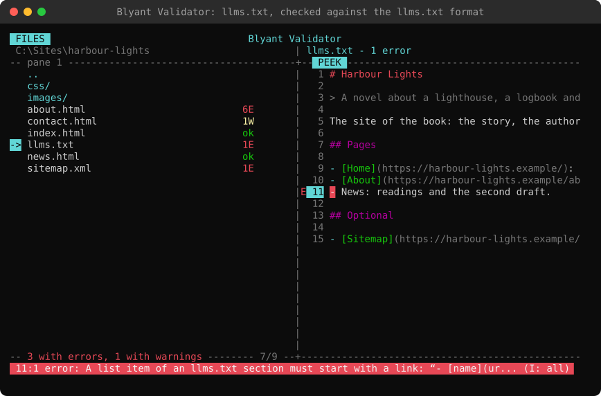

# Blyant Validator

A cross-platform command-line tool that validates and formats HTML and CSS files, and validates XML files such as
sitemaps, Markdown files such as llms.txt, and Typst documents. It's written in
C#/.NET 10 and designed as an optional companion to the [Blyant editor](https://blyant-editor.com/),
but it works on its own too.

**Run it side by side with your favorite editor, for real-time validation of all your files.** The TUI watches the
folders it shows and checks a file again the moment it is saved, so the errors and warnings of your HTML, CSS, XML,
Markdown and Typst are always up to date while you work, in any editor. Peek at a file to see each problem in place, and
format it when you are done.

> **Status: early development (0.5.0).** HTML, CSS, XML, Markdown and Typst validation and the HTML, CSS and
> XML formatters work, and are tried on real sites; more rules will follow.
>
> Blyant Validator has no dependencies besides .NET.



## Credits

Blyant Validator is modelled on two excellent open-source projects:

- **The Nu Html Checker (v.Nu)**: <https://github.com/validator/validator>
- **The W3C CSS Validation Service**: <https://github.com/w3c/css-validator>

See [CREDITS.md](CREDITS.md) for details, and run `blyant-validator credits`.

## Installation

Download the archive for your system from the [releases page](../../releases), and unpack it in a folder of your
choosing: it holds a folder _BlyantValidator_ with the program, `blyant-validator` (`blyant-validator.exe` on
Windows), a short read-me (`README.txt`, with the keys, the commands, the credits and the notices of the licences)
and the licence. The program is a single file with the .NET runtime in it: nothing else has to be installed.

| System | Archive |
| --- | --- |
| Windows (most PCs) | `BlyantValidator-0.5.0-win-x64.zip` |
| Windows on ARM | `BlyantValidator-0.5.0-win-arm64.zip` |
| Linux (most PCs) | `BlyantValidator-0.5.0-linux-x64.tar.gz` |
| Linux on 64-bit ARM (Raspberry Pi with a 64-bit system) | `BlyantValidator-0.5.0-linux-arm64.tar.gz` |
| Linux on 32-bit ARM (Raspberry Pi with a 32-bit system) | `BlyantValidator-0.5.0-linux-arm.tar.gz` |
| macOS on Apple silicon (M1 and later) | `BlyantValidator-0.5.0-osx-arm64.tar.gz` |
| macOS on Intel | `BlyantValidator-0.5.0-osx-x64.tar.gz` |
| Any system with the .NET 10 runtime | `BlyantValidator-0.5.0-portable.zip` |

- **Windows**: unzip it, and run `blyant-validator` in a terminal (Windows Terminal) in that folder, or add the folder
  to your `PATH` to run it anywhere.
- **Linux and macOS**: unpack it with `tar -xzf BlyantValidator-0.5.0-linux-x64.tar.gz` (with the name of the file
  you downloaded), and run `./blyant-validator` (names are case-sensitive). If it was not unpacked with `tar` (some
  programs leave out that it can be run), make it executable once with `chmod +x blyant-validator`. On macOS the
  program is not signed: if macOS refuses to open it, allow it once with `xattr -d com.apple.quarantine
  blyant-validator`.
- **Portable**: with the [.NET 10 runtime](https://dotnet.microsoft.com/download) installed, run
  `dotnet blyant-validator.dll` in the unzipped folder.

The settings of the TUI are kept in a folder `data` next to the program, or, if that folder cannot be written to, in
`Blyant Validator/data` in your application data (see [The TUI](#the-tui)).

## Usage

```
blyant-validator                          (the TUI, where it was left last)
blyant-validator browse   [folder] [options]
blyant-validator validate <paths>... [options]
blyant-validator format   <paths>... [options]
blyant-validator credits
```

### The TUI

Started without a command (or with `browse`), Blyant Validator is a file browser in the terminal, in the style of
the file browser of the Blyant editor: one or two panes, and a peek of the selected file in the other pane.



- Each HTML, CSS, XML, Markdown and Typst file shows its result: `ok`, the number of errors and warnings (`3E 1W`), `...` while it is
  checked, or `failed`. Files are checked in the background, and checked again when they change on disk, so the
  list stays up to date while you edit the files in another program.
- `V` peeks at the selected file: its text in colors, with a mark (`E`, `W`, `i`) in front of the lines with
  problems and the place of each error highlighted. `P` shows the list of its problems instead.
- `Tab` goes into the peek: `j`/`k` move, `n`/`N` go to the next and previous problem (its message is shown on
  the bottom line), `/` searches, `h`/`l` scroll sideways, and in the list of problems `Enter` shows a problem in
  the file. `Tab`, `Esc` or `q` goes back to the list, and a `:` command typed in the peek runs in the list
  (`:ignore` there ignores the problem selected, or the first one on the line of the cursor).
- `I` shows the full text of the problems on the line (in the list of problems: of the selected one) in a box, for
  messages longer than the window is wide. A message that is cut on the bottom line ends with "(I: all)".
- As in Vim, `n`/`N` follow what you looked for last: after a `/` search they go to the matches, and `]`/`[` (which
  always go to problems) make them go to the problems again.
- `F` formats the selected file, or the files marked with `Space`, after asking.
- `T` shows one pane or two, `/` filters the list, `:` opens the command line (`:cd`, `:engine vnu`, `:all` to
  list all files …, with `Tab` completion), and `?` shows all keys. `q` or `Esc` quits, after asking (as in
  Blyant); Ctrl+C quits at once.
- `:number` numbers the rows of the panes, and `:nonumber` takes the numbers away again, as in Blyant. A count in
  front of a key uses them: `5j` and `5k` move 5 rows, `12gg` and `12G` go to row 12 (the count is shown at the
  bottom right of the pane while it is typed, and `Esc` drops it).
- `:path` copies the full path of the selected file or folder to the clipboard, and `:name` its name (on `..`, the
  name of the folder shown), as in Blyant. It is sent with the
  terminal's clipboard sequence (OSC 52), so it works over SSH too, and no other program is started. Most terminals
  take it (Windows Terminal, kitty, WezTerm, Alacritty, iTerm2 …); the Terminal of macOS, GNOME Terminal and the
  Linux console do not, and are told about.
- `:fragment` and `:ignore` change how the files of the folder shown (and its subfolders) are checked; see
  [Fragments and ignored problems](#fragments-and-ignored-problems). A folder that is not fully checked has the
  badges `FRAGMENT` and `IGNORE 2` (two codes ignored) after its path, and the peek says it with the result of a
  file: "no problems (fragment, 3 ignored)".

The TUI needs a window of at least 80×24, like Blyant.

It remembers where it was: the folder and the selected file of both panes, the pane with the focus, and whether one
or two panes were shown, whether the rows are numbered, and the rules of the folders (`:fragment`, `:ignore`). `blyant-validator` (or `browse` without a folder) starts there again; `browse <folder>`
shows that folder in the pane with the focus. The first time, it starts in the current directory. This is kept in
`settings.ini`, in Blyant's format, in the folder `data` next to the program (or, if that folder cannot be written
to, in `Blyant Validator/data` in your application data folder). As in Blyant, a folder `data` with a
`settings.ini` in the directory the program is started in is used instead, for a portable setup.

### Screenshots

The screenshots are of the real program, made with [tools/screenshots.py](tools/screenshots.py) from a made-up
site with mistakes on purpose, as Blyant's are.

| | |
|---|---|
|  |  |
| The files of a site in two panes, each with its result | `V`: the peek, with the lines that have problems marked and each error's place highlighted |
|  |  |
| `Tab` into the peek, and `n` to the next problem: its message on the bottom line | `P`: the problems of the file; `Enter` shows one in the file |
|  |  |
| A style sheet: an unknown property and an unknown unit | `F`: formatting a file, after asking |
|  |  |
| A sitemap, checked by the rules of sitemaps.org | `llms.txt`, checked against the llms.txt format |

Paths can be files or directories. Directories are searched for `.html`, `.htm`, `.xhtml`, `.css`, `.xml`, `.svg`, `.md` and `.markdown` files, `llms.txt` and `llms-full.txt`, and `.typ` files;
add `--recursive` to include subdirectories (folders whose names start with `.`, such as `.git`, and `node_modules`
are passed over, and so are links to folders). Names are matched without regard to case, and a file given twice is
done once.

### validate

| Option | Description |
| --- | --- |
| `-e, --engine native\|vnu` | `native` (default) uses the built-in checker. `vnu` runs the Nu Html Checker; see below. |
| `-o, --output text\|json` | `text` (default) prints `file:line:column: severity: message [code]`. `json` is for editors and scripts. |
| `-r, --recursive` | Search directories recursively (not `.git`, `.vs` …, `node_modules`). |
| `--vnu-jar <path>` | Path to `vnu.jar` (or set `BLYANT_VNU_JAR`). |
| `--java <path>` | Path to `java` (default: `JAVA_HOME`, then `PATH`). |
| `--fragment` | Check HTML files as fragments: the content of a `<body>`, for a page made elsewhere (a CMS). See below. |
| `-i, --ignore <codes>` | Ignore problems with these codes, comma-separated (`css.*` ignores all codes starting with `css.`). Can be given more than once. |

When `--fragment` or `--ignore` is used, the summary says that it was not a full check, and how many problems were
ignored: `2 file(s) checked: 0 error(s), 1 warning(s). Not a full check: HTML checked as fragments; 3 problem(s)
ignored (css.*).`

### format

| Option | Description |
| --- | --- |
| `-w, --write` | Overwrite the files instead of printing the result. |
| `--check` | Change nothing; exit with code 1 if a file isn't formatted. Not with `--write`. |
| `--indent-size <n>` | Spaces per indentation level (default 2). |
| `--use-tabs` | Indent with tabs. |
| `--line-width <n>` | HTML elements whose content fits within this width stay on one line (default 100). |

Without `--write` or `--check`, the formatted text is printed. `--write` only touches files that change, and
replaces them safely (a temporary file is written first), keeping their encoding and line endings. A link is
followed (the file it leads to is written, and the link stays), and a file keeps its permissions (Linux, macOS) or
attributes (Windows). Output is written as UTF-8, also to a file or a pipe.

### Exit codes

| Code | Meaning |
| --- | --- |
| 0 | No errors found (warnings are allowed). |
| 1 | Errors found, or `format --check` found unformatted files. |
| 2 | The tool itself failed: bad arguments, a path that does not exist, a file that cannot be read or written, vnu not available, a file that could not be formatted, or an error of the program itself. The other files are still done. |

A file that is not UTF-8 (Windows-1252, Latin-1, UTF-16 …) is not read: decoded as UTF-8 its other characters would
be lost. `validate` reports it as an error of the file (`file.not-utf8`, with the line of the first byte that is not
UTF-8), and `format` leaves it as it is.

## Fragments and ignored problems

Documentation written for a CMS is often a fragment: headings, paragraphs, code examples, sometimes a `<style>` or
a `<script>`, inserted in a page whose doctype, `<head>` and `<body>` the CMS makes. Checked as a page, such a file
has errors that are not its own (no doctype, no title, no `lang`).

- **Fragment mode** (`--fragment`, or `:fragment` in the TUI) checks an HTML file as the content of a `<body>`. The
  doctype, the title and the language of the page are not checked; everything else is: the markup, attributes,
  content models, ``, duplicate IDs, `<input>` types, and the CSS of `<style>` elements and `style`
  attributes. Parts of a page that a fragment should not have (a doctype, `<html>`, `<head>`, `<body>`, `<title>`,
  `<meta>`, `<base>`) are warnings (`html.fragment-page-part`), as they were most likely pasted in by mistake.
  Fragment mode works with the native engine; vnu checks HTML files as pages.
- **Ignored problems** (`--ignore`, or `:ignore` in the TUI) are left out by their code, the code shown in brackets
  after each problem (`[css.unknown-at-rule]`). A code ending in `.*` ignores all codes that start with it:
  `css.*`, `html.parse.*`. Codes never change, so an ignored code stays ignored when a message is improved.

In the TUI, these are rules of a folder, kept in `settings.ini`; they apply to its subfolders too, unless a subfolder
is changed itself:

| Command | Does |
| --- | --- |
| `:fragment` | The HTML files of the folder shown are fragments; again: full pages. |
| `:ignore code ...` | Ignore problems with these codes in the folder. |
| `:ignore` | In the peek (`Tab`): ignore the code of the selected problem (`P`), or of the first problem on the line of the cursor. Elsewhere: show the codes ignored. |
| `:unignore code ...` | Stop ignoring these codes; without a code: all of them. |

The command line has no saved rules: `validate` checks fully unless `--fragment` or `--ignore` is given, so a script
gives the same result wherever it runs.

Fragment mode cannot know the page the fragment goes into: an `id` that is also used by the CMS's template, for
example, is only found by checking the published page.

## Standards

HTML and CSS no longer have version numbers: both are standards that keep changing. Blyant Validator follows them
as they are now; its rules and data were last brought up to date in **November 2026**. A newer element, attribute or
property that is reported is a gap in the validator, not in your file: please tell about it.

| Files | Checked against |
| --- | --- |
| HTML | The [HTML Living Standard](https://html.spec.whatwg.org/multipage/) of the WHATWG (what "HTML5" is today), as the Nu Html Checker. There is no older version to choose: an HTML 4.01 or XHTML 1.x page is checked by today's rules, and its old features are reported as obsolete. |
| CSS | The current CSS modules of the W3C ([an overview](https://www.w3.org/Style/CSS/current-work)): [Syntax Level 3](https://www.w3.org/TR/css-syntax-3/), [Values and Units Level 4](https://www.w3.org/TR/css-values-4/) (the notation of the grammars), [Selectors Level 4](https://www.w3.org/TR/selectors-4/), [Nesting](https://www.w3.org/TR/css-nesting-1/), [Style Attributes](https://www.w3.org/TR/css-style-attr/), and the modules of the properties, up to the newest (anchor positioning, `@scope`, `@function`). Unlike the W3C CSS Validator, there is no profile to choose (as CSS level 2.1). |
| XML | [XML 1.0](https://www.w3.org/TR/xml/) and [Namespaces in XML](https://www.w3.org/TR/xml-names/): well-formedness, without reading DTDs from outside the file. |
| Sitemaps | The [sitemap protocol 0.9](https://www.sitemaps.org/protocol.html), with dates in the [W3C Datetime](https://www.w3.org/TR/NOTE-datetime) format. |
| Feeds | [RSS 2.0](https://www.rssboard.org/rss-specification) (the RSS Advisory Board), with dates as [RFC 822](https://www.rfc-editor.org/rfc/rfc822); [Atom](https://www.rfc-editor.org/rfc/rfc4287) (RFC 4287), with dates as [RFC 3339](https://www.rfc-editor.org/rfc/rfc3339). |
| Markdown | [CommonMark](https://spec.commonmark.org/), as far as the checks need it, with the heading anchors GitHub makes. |
| Typst | The [syntax of Typst](https://typst.app/docs/reference/syntax/) as the Typst compiler 0.15 reads it, as far as it can be told without compiling: the errors found were compared with the compiler's, on real documents and on hundreds of damaged copies of them. |
| llms.txt | The [llms.txt format](https://llmstxt.org/), built in: nothing is fetched. |

## What is checked

### CSS

- **Syntax**, following CSS Syntax Level 3: unclosed blocks, strings, comments and `url()`, missing `:`,
  stray `}`.
- **Property names**: unknown properties are errors, with a suggestion for typos ("Did you mean
  “background-color”?"). Vendor-prefixed names (`-webkit-…`) are reported as info.
- **Property values**, checked against grammars written in the notation of the CSS specifications
  (`src/Blyant.Validator.Css/Data/properties.txt`), with ranges such as “no negative padding”. Values
  that use `var()`, `env()` or `attr()` are not checked: a false error is worse than a missed one. All 497 known
  properties have a grammar but the non-standard `font-smooth`: grid templates (`repeat()`, `minmax()`, line names,
  `subgrid`), `content`, masks and mask borders, SVG strokes, motion paths (`offset-*`), scroll-driven animations and
  anchor positioning (`position-area`, `position-try-fallbacks`) included.
- **Units**: unknown units (`10pz`) are errors everywhere.
- **Selectors**: unknown pseudo-classes and pseudo-elements, IDs starting with a digit, misplaced
  combinators, empty selectors. Nested rules (CSS Nesting) are supported.
- **At-rules**: unknown at-rules (warning), `@charset` and `@import` in the wrong place, `@font-face`
  descriptors, keyframe selectors.

### HTML

- **Parse errors**, as the HTML standard defines them: missing or obsolete doctype, unclosed elements,
  stray end tags (`</span>` with no `<span>`, `</p>` with no `<p>`, `</br>`), duplicate attributes, missing
  space between attributes, bad characters in unquoted values, `/>` on non-void elements, nested `<a>`,
  `<form>` and `<button>`, text directly inside tables, broken comments (`<!-->`, `--!>`, nested `<!--`),
  CDATA and `<?…?>` in HTML, bad character references (`&#xZZ;`, `&#0;`, `&copy` without `;`), and
  the end of the file inside a tag, comment or element. End tags that HTML lets you leave out (`</li>`,
  `</p>`, `</td>` …) are not reported.
- **Elements and attributes**: unknown elements (custom elements with a `-` are allowed) and unknown
  attributes (`data-*`, `aria-*` and event handlers are allowed); wrong values of boolean attributes
  (`disabled="false"`), of attributes with a set of values (`type`, `method`, `loading`, `dir` …), of numbers
  (`width="100px"`), IDs and URLs (spaces, backslashes); required attributes (`src` on ``, `rel` and
  `href` on `<link>`, `content` on `<meta name>` …); `<label for>` pointing at no element.
- **Obsolete elements and attributes**: `<center>`, `<font>`, `<marquee>`, `align`, `bgcolor`, `cellpadding`,
  `<a name>` … with what to use instead; `border="0"` on images, `border="1"` on tables and an unneeded `type`
  on `<script>` and `<style>` are warnings.
- **Content models**: what lists, definition lists, tables, `<select>`, `<head>` and `<picture>` may hold; where
  `<li>`, `<dt>`/`<dd>`, table parts, `<option>`, `<figcaption>`, `<legend>`, `<summary>` and `<source>` may be;
  blocks inside inline elements (`<div>` in `<span>`, also through `<a>`); links and buttons inside links and
  buttons; text where only elements may be; more than one visible `<main>`; `<header>`/`<footer>` inside each other,
  headings and sections inside `<address>`, `<main>` inside `<article>`, `<aside>`, `<nav>`, `<header>` or `<footer>`;
  `<dfn>`, `<label>`, `<meter>` and `<progress>` inside themselves; a `<label>` with more than one control, or a control
  whose ID is not the label's `for`; `<hgroup>` without exactly one heading; empty headings (a warning).
- **`<input>` per type**: attributes that do not apply to the type (`min` on a text field, `placeholder` on a checkbox,
  `checked` on an e-mail field, `value` on a file field …), and the form of `min`, `max`, `step` and `value` for
  numbers, dates, months, weeks, times, colors and URLs (`2026-11-10`, `14:30`, `#336699` …).
- **CSS in the page**: `<style>` elements and `style` attributes are checked with the CSS validator, with the
  places of the problems in the HTML file.
- Missing `<title>` and `lang`, `` without `alt`, duplicate IDs.

SVG and MathML inside a page are only checked for parse errors.

### XML

- **Well-formedness** of `.xml`, `.svg` and `.xhtml` files (XML 1.0): unclosed and mismatched tags, duplicate
  attributes, a bare `&`, HTML entities such as `&nbsp;` that XML does not know, more than one root element … The
  first mistake is reported, at its line and column (XML stops there, as browsers do). Entities declared in the file
  itself (its internal DTD subset, as Adobe Illustrator's SVG has) are known; nothing outside the file is ever
  loaded: an entity of an external DTD is a warning (`xml.undeclared-entity`), as is an entity declared to be in
  another file (`xml.external-entity`), and entities may expand to at most 10,000,000 characters.
- **Sitemaps** (`urlset` and `sitemapindex`), by the rules of [sitemaps.org](https://www.sitemaps.org/protocol.html):
  the namespace, UTF-8, a required `<loc>` with an absolute http(s) URL of at most 2,048 characters, `lastmod` as a
  W3C date (`2026-11-10`), `changefreq` and `priority` values, unknown or repeated elements, at most 50,000 entries
  and 50 MB; URLs listed twice and URLs of another host are warnings. Extensions (`image:`, `video:`, `news:`,
  `xhtml:link`) are allowed.
- **News feeds**: RSS 2.0 (the [RSS Advisory Board's spec](https://www.rssboard.org/rss-specification)): `version`,
  one `channel` with `title`, `link` and `description`, items with a `title` or `description`, RFC 822 dates
  (`Tue, 10 Nov 2026 14:30:00 GMT`; a wrong weekday is a warning), absolute links, a `guid` that is a URL unless
  `isPermaLink="false"`, `enclosure`, `ttl`, `image`, `skipHours` and `skipDays`. Atom (RFC 4287): `id`, `title`
  and `updated` on the feed and its entries, an author, RFC 3339 dates (`2026-11-10T14:30:00Z`), ids as absolute
  IRIs, `link href`, content or an alternate link. Extensions in a namespace (`atom:link`, `content:encoded`,
  `dc:creator`, `itunes:*`) are allowed. Feeds can be `.xml`, `.rss` or `.atom` files.
- XML is checked natively also with `--engine vnu`.

### Markdown and llms.txt

Markdown has no invalid documents, so its checks are warnings, about what probably does not show as meant:

- A code block (````` or `~~~`) that is never closed, which makes the rest of the file code.
- `#Heading` without a space (not a heading), empty headings, more than one level 1 heading, and levels that skip
  one (`#` to `###`).
- Links: `[text](` not closed on its line, empty targets `[text]()`, references `[text][label]` with no
  `[label]: url`, labels defined twice, `#anchors` with no heading (or `id`) of that name in the file, and relative
  links and images to files that do not exist.

Code (fenced and indented), code spans and front matter are not checked. Web addresses are not visited: only the
`#anchors` of the file and relative paths on the disk are looked up.

`llms.txt` (and only that name: other `.txt` files are not checked) is also checked against the
[llms.txt format](https://llmstxt.org/), whose rules are built in, so nothing is fetched: it starts with one `# Name`,
(optionally) a `> summary` and some text, then `##` sections that are lists of links `- [name](url): notes`.
Breaking the format is an error; a URL listed twice is a warning. `llms-full.txt` is checked as Markdown, with any
number of level 1 headings.

### Typst

Typst (`.typ`) is checked for what the Typst compiler refuses, and that can be told without compiling the document.
Typst has three modes, the text (markup), code (after `#`, and in its brackets) and math (between `$`), and the
checks follow them as the compiler does:

- **Not closed**: raw text and blocks (`` ` `` and ```` ``` ````), strings, equations (`$`), and brackets of code and
  content (`#text(red)[Hello`).
- **Strong and emphasis**: a `*` or `_` not between two letters or digits starts *strong* or _emphasis_ text, which
  must be closed before the end of its paragraph, heading, list item or content: `Five * three` is an error (write
  `\*`), `5*3` and `snake_case` are text.
- **Closed but not opened**: a `]` in the text with no `[`, and a `)`, `}` or `]` in code that closes nothing.
- **`#` with no code after it** (`C# language`: write `\#`).
- **References**: an `@reference` to a label that is not in the document, or that is there more than once; the
  document is the file, the files it includes, and the files that include it (in its folder and the folder above),
  so a chapter may refer to a label of another. An e-mail address in the text is a reference to Typst: write
  `\@`. References are not checked when labels are made by code (`label("…")`), with a bibliography (its keys are
  referred to with `@`), or with a package.
- **Files**: a file given to `#include`, `#import`, `image()`, `read()`, `json()`, `bibliography()` … that is not
  there (relative to the file; a path from the root of the project, `/…`, is not checked).
- **Packages** are checked for their name only (`@preview/name:1.0.0`): nothing is fetched.
- Warnings: `=Heading` without its space (it is text), and a label in a file more than once.

What code means is the compiler's to tell, and is not checked: an unknown function or variable, the arguments of a
call, a `set` or `show` rule, fonts. Typst files are not formatted (line breaks and spaces carry meaning in the
text). In the TUI they are shown in Blyant's Typst colors.

## Formatting

Formatting only changes layout; the formatted file means exactly the same as before. Files are read and written
as UTF-8 (with or without a BOM, as they had), with the line endings they mostly use (CRLF, LF or CR). A file that
is not UTF-8 is not formatted, nor one nested deeper than the program follows (512 elements, 256 CSS blocks or
parentheses).

- **CSS**: one selector and one declaration per line, blocks indented, `: ` after property names,
  whitespace inside values made single spaces, one space before `!important`, and a missing last `;` added. Every
  token is kept as written: comments (also inside a declaration), escapes in names (`--my\:var`) and the case of
  `!IMPORTANT`. Comments are kept, and so is one empty line where the file had empty lines. Custom properties
  (`--name`) keep their value exactly as written. A file with a block that is never closed, or a string with a
  line break in it, is not formatted.
- **XML**: elements that hold only elements get their children on lines of their own, indented. Kept exactly as
  written: an element with text in it (a `<loc>`, a `<title>`, mixed content) or only whitespace, everything under
  `xml:space="preserve"`, SVG text (`<text>`, `<tspan>`, `<textPath>`), and XHTML (an element that declares the XHTML
  namespace, as in Atom's `type="xhtml"` content), where whitespace between elements shows. Comments, CDATA, the declaration and the doctype are kept, and one empty line where the
  file had empty lines. Runs of spaces between attributes become one space. A file that is not well-formed is not
  formatted.
- **HTML**: block-level elements (`div`, `p`, `li`, `table` …) get lines of their own and are indented.
  Text and inline elements stay together, keeping the line breaks of the source; elements whose content
  fits within `--line-width` stay on one line. Whitespace is only added or removed where the browser
  ignores it: a `<script>`, `<link>` or `<noscript>` right next to text stays in the line. The contents of `<pre>`,
  `<textarea>` and `<script>` are kept exactly as written; `<style>` elements are formatted as CSS. HTML inside an
  SVG `<foreignObject>` is formatted as HTML. End tags that the source leaves out (`</li>`, `</td>`, `</p>` …) are
  not added. A file that ends inside a tag is not formatted.

### JSON output

```json
{
  "diagnostics": [
    {
      "file": "index.html",
      "severity": "error",
      "code": "html.img-missing-alt",
      "message": "An “img” element must have an “alt” attribute, except under certain conditions.",
      "line": 12, "column": 5, "endLine": 12, "endColumn": 5,
      "engine": "native"
    }
  ],
  "fragment": false,
  "ignore": [],
  "ignored": 0
}
```

`fragment` tells whether HTML files were checked as fragments, `ignore` lists the codes given with `--ignore`, and
`ignored` is the number of problems left out.

### Using the Nu Html Checker (`--engine vnu`)

For the most complete HTML checking, Blyant Validator can run the Nu Html Checker itself:

1. Install a Java runtime.
2. Download `vnu.jar` from <https://github.com/validator/validator/releases>.
3. Run `blyant-validator validate index.html --engine vnu --vnu-jar path/to/vnu.jar`,
   or set `BLYANT_VNU_JAR` once and leave out `--vnu-jar`.

## Building

Requires the [.NET 10 SDK](https://dotnet.microsoft.com/download).

```
dotnet build
dotnet test
dotnet run --project src/Blyant.Validator.Cli -- validate index.html
```

On Windows the program has an icon in the style of Blyant's, with a checkmark:
`src/Blyant.Validator.Cli/BlyantValidator.ico` (and `.svg`), drawn by `python tools/icon.py` (needs Pillow; only to
draw the icon, not to build). The social preview of the repository on GitHub, `tools/github-social-preview.png`
(1280 x 640, in the style of Blyant's), is drawn by `python tools/social.py`, and uploaded by hand in the settings of
the repository.

The release versions are built by `publish.ps1` (PowerShell 7.3 or later), as Blyant's are: it runs the tests
first, checks that the version is the same in `Directory.Build.props` and in the status line of this read-me, and
builds a self-contained single file for Windows, Linux and macOS (x64 and ARM), and the portable version, in
_publish_. Each is also packed for the [releases page](../../releases) in _publish/release_: a zip for Windows and the
portable version, and a tar.gz for Linux and macOS (where the program is marked as one that can be run), with
`README.txt` (made from `docs/release/README.txt`, with the version and the address of the repository filled in) and
`LICENSE` next to the program.

```
./publish.ps1                     (all versions)
./publish.ps1 win-x64,linux-x64   (the ones named)
./publish.ps1 -SkipTests          (without running the tests first)
```

One version by hand, with a runtime identifier such as `win-x64`, `linux-arm64` or `osx-arm64`:

```
dotnet publish src/Blyant.Validator.Cli -c Release -r win-x64 --self-contained
```

## Project layout

| Project | Purpose |
| --- | --- |
| `src/Blyant.Validator.Core` | Shared types: `Diagnostic`, `IValidator`, `IFormatter`, credits. |
| `src/Blyant.Validator.Html` | HTML reader with parse errors (`Parsing/`), validator rules (`Rules/`) and formatter. |
| `src/Blyant.Validator.Css` | CSS tokenizer and parser (`Syntax/`), value grammars (`Values/`, `Data/`), validator and formatter. |
| `src/Blyant.Validator.Xml` | XML validator: well-formedness and sitemaps. |
| `src/Blyant.Validator.Markdown` | Markdown reader and validator, and the llms.txt format. |
| `src/Blyant.Validator.Typst` | Typst reader (markup, code and math) and validator. |
| `src/Blyant.Validator.Vnu` | Adapter that runs `vnu.jar` and converts its JSON output. |
| `src/Blyant.Validator.Cli` | The `blyant-validator` program: the commands, and the TUI in `Tui/` (its terminal parts in `Tui/Terminal/` and the highlighters in `Tui/Highlighting/` are adapted from Blyant). |
| `tests/Blyant.Validator.Tests` | xUnit tests. |

Rules for working on the code are in [AGENTS.md](AGENTS.md); changes are listed in [CHANGELOG.md](CHANGELOG.md).

## Roadmap

- [x] Solution structure, CLI, text and JSON output
- [x] HTML: parse errors, plus rules for title, lang, img alt and duplicate IDs
- [x] Optional `--engine vnu` backend
- [x] CSS: tokenizer and parser following CSS Syntax Level 3
- [x] CSS: property, value, unit, selector and at-rule checks
- [x] HTML and CSS formatters
- [x] TUI: file browser with results, peek with problems marked, formatting
- [x] CSS: grammars for grid templates, generated content, masks, SVG and more (469 of 497 properties)
- [x] HTML: content-model rules, attribute checks, obsolete elements
- [x] HTML: check `<style>` elements and `style` attributes with the CSS validator
- [x] CSS: grammars for the last new features (anchor positioning areas, `offset-*`, `mask-border-*`)
- [x] HTML: more content models (forms, headings, sectioning), and the attributes of `<input>` per type
- [x] XML: well-formedness, and sitemaps
- [x] XML: formatting, and RSS/Atom feeds
- [x] Markdown checks, and the llms.txt format
- [x] Fragments (HTML for a CMS) and ignored problem codes, per folder in the TUI
- [x] Typst: what the compiler refuses without compiling, references, files and packages
- [ ] Typst: an optional `--engine typst` that runs the Typst CLI for all its errors
- [ ] Comparison test suite against vnu output
- [x] Release builds for Windows, Linux and macOS (`publish.ps1`)
